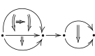

本文是用现代语言对 OpenAI 2026 年 10 月在 [Github 仓库](https://github.com/openai/math/tree/main/preprints/The-Grothendieck-homotopy-hypothesis-via-elementary-expansions-September-24-2026)发布的[文章](OAIGHH.md)的解读.

## 背景

[Grothendieck 同伦假设](同伦假设.md)说的是一类[球状集](球状集.md)上由所谓 [Grothendieck 融贯子](融贯子.md) (coherator) 定义的[代数结构](代数.md) [^1] 构成的 $(1,1)$-范畴在适当的[局部化](局部化(范畴论).md)之下可以用来[表现](数学对象的表现.md)同伦型的 $(\infty,1)$-范畴, 即今天所谓[生象](生象.md)的范畴 [$\mathsf{Ani}$](Ani.md).

我们知道[单纯集](单纯集.md)的范畴 $\mathsf{sSet}$ 已经可以表现 [$\mathsf{Ani}$](Ani.md). 但 "[球状集](球状集.md) + [融贯子](融贯子.md)" 的路线仍有一些优越性.

[^1]: 传统上称为**弱球状 $\infty$-群胚** (weak globular $\infty$-groupoids), "弱" 的意思是其中结合律之类的 "等式" 是由更高维胞腔给出的. 人们还考虑过另一个概念 (模型), 叫做**严格 (球状) $\infty$-群胚**, 它不足以涵盖所有同伦型. 今天 "$\infty$-群胚" 的含义已经变化, 成为了一个模型无关的概念, 故我们放弃 "弱 ... $\infty$-群胚" 这个名称, 换用更直白的说法: 由融贯子定义的代数结构.

[OpenAI 的文章](OAIGHH.md)延续 [Simon Henry 文章](HenryAlgModHomTyp.md)的思路, 解决了其中的一个引理, 从而完成了同伦假设的证明. 两篇文章都使用[模型范畴](模型范畴.md)语言. 但即使剥去模型, 两篇文章仍有实质内容, 本笔记的目的即是解读其中的 "模型无关" 内容.

## 基本概念速览

本节总结用现代语言理解文章所需的基本概念. 欲了解详细内容请点击相应链接.

[Joyal 范畴 $\Theta$](Joyal范畴.md) 由用于[探测](探测.md) $(\infty,n)$-范畴的基本对象构成, 如下是其一个对象的示意.

记 $\Theta_0$ 为 $\Theta$ 中惰性映射构成的[宽子范畴](宽子范畴.md). 所谓[惰性映射](代数模式.md)是不承载代数运算的映射, 在这里就是指 $\Theta$ 的对象作为[球状集](球状集.md)的含入映射.

一个[融贯子](融贯子.md) $\Theta_0 \to \mathcal C$ 是向 $\Theta_0$ 添加一些活性映射所得的一种[代数模式](代数模式.md), 直观上是指定球状结构中 "态射" 如何 "复合", 满足何种 "结合律" 的方式. 代数模式的基本对象为胞腔 $D_0, D_1, D_2,\cdots$. 基本对象与惰性映射构成范畴 $\Theta_{\mathrm{el}}$, [球状集](球状集.md)正是 $\Theta_{\mathrm{el}}$ 上的[预层](预层.md).

定义一个[融贯子](融贯子.md) $\mathcal C$ 的**模型**为其 $\mathsf{Set}$-值 Segal 对象:
$$
\mathsf{Mod}(\mathcal C) := \mathsf{Seg}_{\mathcal C} (\mathsf{Set}).
$$
不同的融贯子会给出不同的模型的范畴 (作为 $(1,1)$-范畴), 而同伦假设告诉我们在适当的 "[弱等价](带弱等价的范畴.md)" 概念的[局部化](局部化(范畴论).md)之下, 这些范畴[表现](数学对象的表现.md)同一个 $(\infty,1)$-范畴, 也就是 [$\mathsf{Ani}$](Ani.md).

## 记号

对于融贯子的模型 $X$, 它首先是一个球状集; 对任何球状集有如下运算 (实际上是 "惰性" 运算):

- 以 $\alpha\colon u \to v$ 表示胞腔 $\alpha$ 以 $u,v$ 为起点和终点;
- 对于 $r$-胞腔 $\alpha$ 与 $i < r$, 以 $s_i\alpha$ 表示迭代 "起点" 运算 $s$ 得到的 $i$-胞腔 $ss\cdots s\alpha$, 类似地定义 $t_i\alpha$.

由于融贯子的定义, 可选定融贯子中的一系列填充, 使得其每个模型 $X$ 获得如下代数运算 ("活性" 运算):

- 对于 $X$ 的每个 $p$-胞腔 $u$ 给出一个 $(p+1)$-胞腔 $e(u)\colon u\to u$ ("恒等"), 以 $e_p^q (u)$ 表示迭代到 $q$-胞腔;
- 对于 $X$ 的每个 $r$-胞腔 $\alpha,\beta$ 与 $i < r$, 满足 $s_i\beta = t_i\alpha$, 给出一个 $r$-胞腔 $\alpha *_i \beta$ ("第 $i$ 方向复合"), 满足 $s_i (\alpha *_i \beta) = s_i \alpha$, $t_i (\alpha *_i \beta) = t_i \beta$;
- 对于 $X$ 的每个 $r$-胞腔 $\alpha$ 与 $i < r$, 给出一个 $r$-胞腔 $w_i (\alpha)$ ("第 $i$ 方向取逆"), 满足 $s_i w_i \alpha = t_i \alpha$, $t_i w_i \alpha = s_i \alpha$.

**注意**.

- 这些操作的定义涉及一个手动的、额外的选择, 因为融贯子只要求了填充存在; 这些选择不由 $\mathcal C$ 决定, 但由我们一劳永逸地手动固定.
- 尽管如此, 请细心的读者分辨上面所说的现象和用 [Kan 复形](Kan复形.md)作为生象的模型时的 "填充不唯一" **不是同一层面的现象**:
  - 在这里我们遇到的是**理论**层面的填充不唯一, 而 Kan 复形则面对**模型**层面的填充不唯一;
  - 在我们选定了一个融贯子中的上述填充之后, 它的所有模型立刻获得了明确的填充运算.

---

考虑沿[代数模式](代数模式.md) $\mathcal C$ 到终模式 $1$ 的态射的左 Kan 扩张, 即余极限函子
$$
L := \operatorname{colim}_{\mathcal C^{\mathrm{op}}}
\colon \mathsf{Seg}_{\mathcal C}(\mathsf{Ani}) \to \mathsf{Seg}_1(\mathsf{Ani}) = \mathsf{Ani}.
$$

限制在 $\mathsf{Set}$-值 Segal 对象的全子范畴, 有函子
$$
\mathsf{Mod}(\mathcal C) \to \mathsf{Ani}.\,(\star)
$$
要证明同伦假设, 我们手动定义 $\mathsf{Mod}(\mathcal C)$ 上的[弱等价](带弱等价的范畴.md) $\mathcal W$, 然后证明 $(\star)$ 是关于 $\mathcal W$ 的[局部化](局部化(范畴论).md):
$$
\mathsf{Mod}(\mathcal C)[\mathcal W^{-1}] \overset{\simeq}{\to} \mathsf{Ani}.
$$

### 同伦群

设 $X$ 为融贯子 $\mathcal C$ 的模型, 定义其同伦集 $\pi_r$:

对于平行 $(r-1)$-胞腔 $u,v$ 以及 $\alpha,\beta\colon u\to v$, 定义 $\alpha \sim \beta$ 表示**存在** $(r+1)$-胞腔 $\gamma\colon \alpha\to\beta$.
定义
$$
\pi_r(X;u,v) := \{\alpha\colon u\to v\}/\sim\,(r\geq 1),
$$
$$
\pi_0 (X) := X_0 / \sim.
$$
对 $x\in X_0$ 定义
$$
\pi_r (X,x) := \pi_r (X;e_0^{r-1}(x),e_0^{r-1}(x)).
$$

容易相信, $\pi_r (X,x)$ 在 $r\geq 1$ 时有群结构.

注意, 同伦集以及其间的映射不依赖于 $\mathcal C$ 中活性运算的具体填充的选取.

**定义**. 令 $\mathcal W$ 为 $\mathsf{Mod}(\mathcal C)$ 中诱导所有 $\pi_0$ 与 $\pi_r (X,x)$ 双射的态射构成的类.

**引理**. 胞腔 $\alpha\colon u\to v$ 给出同伦集的双射
$$
\alpha * (-) \colon \pi_r (X;v,w) \to \pi_r (X; u,w).
$$

**引理**. 对胞腔 $u$ 的顶点 $x$, 有双射 $\pi_r(X;u,u) \simeq\pi_r(X,x)$.

这两个引理的证明对于熟悉拓扑学的人都是直观的. 关键在于为了构造 "除法" 即 $\alpha * (-)$ 的逆运算, 需要

**命题** (弱等价检验). 对于 $\mathsf{Mod}(\mathcal C)$ 中的态射 $f\colon X\to Y$, 如下条件等价.

1. $f\in\mathcal W$.
2. $f$ 在 $\pi_0$ 上为单射, 且对 $r\geq 1$ 与每对平行胞腔 $u,v$, 给出双射 $\pi_r (X;u,v) \to \pi_r (Y;fu,fv)$.
3. 对任意 $r\geq 0$, $b\colon \partial D_r \to X$, 以及 $Y$ 中以 $fb$ 为边界的 $r$ 维胞腔 $y$, 都存在 $X$ 中以 $b$ 为边界的 $r$ 维胞腔 $x$ 以及 $Y$ 中的 $(r+1)$ 维胞腔 $fx \to y$.

*证明*. 使用前面两个引理, 证明不难.

称 $X\in\mathsf{Mod}(\mathcal C)$ 可缩是指 $(X\to 1)\in\mathcal W$.

由弱等价检验的第 3 个条件, $X$ 弱可缩当且仅当 $X$ 中任意两个平行胞腔之间都有填充.

**命题**. $\mathcal W$ 满足 "三中之二" 性质, 关于箭头范畴中的[收缩](收缩.md)和[滤余极限](滤余极限.md)封闭. 这使 $(\mathsf{Mod}(\mathcal C),\mathcal W)$ 构成了一个[带弱等价的范畴](带弱等价的范畴.md).

注意, "带弱等价的范畴" 这个概念与[模型范畴](模型范畴.md)**没有**必然联系.

### 基本扩张

考虑模型 $X\in\mathsf{Mod}(\mathcal C)$ 的 $n$ 维胞腔 $D_n \to X$. 定义其**基本扩张**为 $\mathsf{Mod}(\mathcal C)$ 中沿 $s \colon D_n \to D_{n+1}$ 的推出 $X \to X^+$, 也即自由地添加一个平行于 $\alpha$ 的 $n$ 维胞腔 $\beta$, 以一个 $(n+1)$ 维胞腔 $\gamma\colon \alpha\to\beta$ 相连. 当然, 由于模型的代数结构, 还会生成出许许多多的胞腔, 这正是这个概念的复杂所在.

[OpenAI 文章](OAIGHH.md)证明的主定理, 也即 [Simon Henry](HenryAlgModHomTyp.md) 遗留的关键引理是如下定理.

**定理**. 基本扩张是弱等价.

