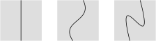
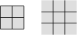
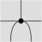
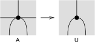
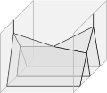
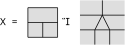
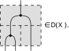
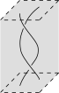

本文是 [Lukas Heidemann 博士论文](HeidemannMfdDiag.md)的阅读笔记.

## 引言

本文建立高阶范畴中的一种基于流形的图形演算 (graphical calculus), 它是[线图](线图.md)的推广.

在流形图中, 维数最大的区域 (开区域) 代表范畴中的对象, 区域之间的余 $1$ 维界面代表 $1$-态射, ..., 余 $k$ 维界面代表 $k$-态射.

流形图的拼接给出高阶态射的复合, 而形状本身就带有[融贯性](融贯.md).

## 分层流形

拓扑空间的[分层](分层.md)就是其到一个偏序集的映射, 其中偏序集带有 [Alexandroff 拓扑](Alexandroff拓扑.md).

分层空间 $X$ 上的**标架**是其到 $\mathbb{R}^n$ 的一个嵌入 $X\hookrightarrow\mathbb{R}^n$. 这里我们关心的其实是这个嵌入到后 $m$ 分量的投影定义的等价关系. 记 $\sim_m$ 为 $\mathbb{R}^n$ 上由 "后 $m$ 个分量相同" 定义的等价关系. 我们要求带标架分层空间之间的映射保持这些关系, 即若 $x\sim_m y$, 则 $f(x)\sim_m f(y)$.
例如下面三幅图中, 左边的竖线和中间的曲线是等同的, 而两者和右边的折返曲线是**不同**的.

下面三幅图中, 底层两个 $0$ 维的点可以左右移动, 左边和中间是等同的, 而两者和右边是不同的.

## 网格与桁架

### 网格

**定义** (分层纤维丛).
满足如下条件的分层空间映射 $p\colon E\to B$ 称为**分层纤维丛**:

- 对任意点 $b\in B$, 设 $T_b\subset B$ 为其所在的层, 则存在 $b$ 在 $T_b$ 中的开邻域 $U$ (注意不一定是 $B$ 中的开邻域), 使得 $p\colon E|_U \to U$ 同构于一个形如 $U\times F\to U$ 的分层空间映射.

**定义** (网格). 对自然数 $n$ 归纳定义 $n$ 维的**闭网格**:

- $0$ 维闭网格是一个点;
- $1$ 维闭网格是带有分层的闭区间, 其每一层都是单点或开区间;
- $n+1$ 维闭网格是一个分层纤维丛 $E\to B$, 其中每个纤维都是闭区间, 且纤维的分层结构的每一层都是单点或开区间.

将上述定义中 "闭区间" 改为 "开区间", 就得到**开网格**:

- $1$ 维开网格是带有分层的开区间, 其每一层都是单点或开区间;
- $n+1$ 维开网格是一个分层纤维丛 $E\to B$, 其中每个纤维都是开区间, 且纤维的分层结构的每一层都是单点或开区间.

注意上述定义可以容易地推广到开/闭 $n$-**网格丛**的定义. 而使用分层单形上的这种丛, 我们就可以定义开 $n$-网格的范畴 $\mathcal M^n$.

特别地, $1$ 维标准分层单形上的开 $n$-网格丛就是 $\mathcal M^n$ 中的态射, 也叫做**配边** (bordism). (当然这和通常流形的配边不太一样, 只是借用了名字.)

**命题**. 闭网格的范畴是开网格的范畴的反范畴: $\overline{\mathcal M}^n \simeq (\mathcal M^n)^{\mathrm{op}}$.

例如, 下图中的 "田" 字形闭网格 $\text{田}\in\overline{\mathcal M}^2$ 对应于 "井" 字形开网格 $\text{井}\in\mathcal M^2$.

### 桁架

桁架是网格的纯组合版本, 是网格的[出路范畴](出路范畴.md)的隐喻; 桁架的范畴和网格的范畴等价.

**定义** ([桁架](桁架.md)).

- $1$ 维闭桁架的范畴为 $\Delta^{\mathrm{op}}$.
- $1$ 维开桁架的范畴为 $\mathcal{T}^1 := \Delta$.
- $n+1$ 维开桁架 $T$ 是一个 zig-zag
  $$
    T_{r_0}\leftarrow T_{s_0} \to T_{r_1}\leftarrow\cdots\to T_{r_n},
  $$
  其中每个 $T_{r_i},T_{s_i}$ 都是 $n$ 维开桁架, 态射是偏序集映射 $\alpha\colon [n]\to [m]$ 以及一些态射
  - $T_{r_i} \to S_{r_{\alpha(i)}}$,
  - $T_{s_i} \to S_{s_j}$ ($\alpha(i)\leq j <\alpha (i+1)$),
  - $T_{s_i} \to S_{r_j}$ ($\alpha(i)\leq j \leq\alpha (i+1)$).

我们通过一个[多项式函子](多项式函子.md)归纳定义高维的开桁架:

由于开 $1$-桁架的范畴为 $\Delta$, 同时一个开 $1$-桁架自身也可视为一个偏序集, 我们可以考虑 "[万有](分类空间.md)开 $1$-桁架丛", 即一个[纤维范畴](纤维范畴.md)
$$
p\colon \mathcal {T}^1_*\to \Delta,
$$
(实际上是一个 Conduché 纤维化, 即 $\mathsf{Cat}$ 中[可作指数](指数对象.md)的态射)

- 其落在 $[n]$ 上的纤维 $p^{-1}([n])$ 恰为 $[n]$ 对应的开 $1$-桁架
  $$
    r_0[n] \leftarrow s_0[n] \to r_1[n]\leftarrow s_1[n]\to\cdots \to r_n[n],
  $$
  (注意它正是开 $1$-网格的[出路范畴](出路范畴.md))
- 其落在 $\alpha\colon [n]\to [m]$ 上的态射为 $r_i [n] \to r_{\alpha(i)} [m]$, $s_i[n] \to s_j [m]$ ($\alpha(i)\leq j <\alpha (i+1)$), $s_i[n]\to r_j [m]$ ($\alpha(i)\leq j \leq\alpha (i+1)$).

考虑 $\mathsf{Cat}$ 中的[多项式](多项式函子.md)
$$
  {*} \leftarrow \mathcal{T}^1_{*} \to \Delta \to *,
$$
其给出多项式函子
$$
\operatorname{T}^1\colon \mathcal C\mapsto \int_{[n]\in\Delta} \mathcal C^{p^{-1}([n])}.
$$
直观上, $\operatorname{T}^1 (\mathcal C)$ 的对象为 "带 $\mathcal C$ 标签的 $1$-桁架".

### 原子与胞腔, 奇异型

**定义**.

- 称偏序集有**最小元**的**开** $n$-网格为**原子**.
- 称偏序集有**最大元**的**闭** $n$-网格为**胞腔**.

**定义** (奇异型) 对于原子或胞腔 $X$, 由定义其为一串分层纤维丛
$$
X  = X_n \overset{f_{n}}{\to} X_{n-1} \to \cdots \overset{f_1}{\to} X_0 = *.
$$
定义 $X$ 的**奇异型** (singularity type) $\operatorname{stype}(X)$ 为 0-1 序列 $[k_1,\cdots,k_n]\in\Delta^n$, $k_i$ 当 $X_i\to X_{i-1}$ 为平凡分层纤维丛时取 $0$, 否则取 $1$.

**构造**. 设 $M\to P$ 为开 $n$-网格, 对 $p\in P$, 记包含 $p$ 的最小的开子网格为 $\operatorname{atom}_M(p)\subset M$; 它是一个原子. 所有这样的子网格 $\operatorname{atom}_M (p)\to M$ 构成 $n$-网格范畴中的余极限余锥.

## 开网格的代数模式

本节描述开 $n$-网格或开 $n$-桁架如何构成一个[代数模式](代数模式.md) $\mathcal T^n$, 基本对象为原子, 惰性映射为嵌入.

### 活性映射

**定义**. 对于开 $n$-网格的配边, 即 $\mathcal M^n$ 中的态射 $X\to Y$, 对应于开 $n$-网格丛 $E\to \|\Delta [1]\|$, 若对任意 $p\in P_Y$, 存在 $q\in P_X$ 使得在 $P_E$ 中 $p\leq q$, 则称之为**活性映射**或活性配边.

> 其实直观上就是盖满了.

### 田字格

由开 $n$-网格与桁架的直观很明显有嵌入
$$
\boxplus\colon \Delta^n \hookrightarrow \mathcal M^n\simeq\mathcal T^n.
$$

函子 $\boxplus\colon \Delta^n \to \mathcal T^n$ 诱导伴随
$$
(\boxplus^*\dashv \boxplus_*)\colon \widehat {\mathcal T^n} \rightleftarrows \widehat {\Delta^n},
$$
其中右伴随 $\boxplus_*$ 为[全忠实函子](全忠实函子.md).

**例**. 设 $\mathcal C$ 为 $(\infty ,2)$-范畴, 视为 $2$ 重 Segal 生象. 设 $A$ 为如下原子.

我们计算 $\boxplus_*\mathcal C (A)$. 由[预层之间伴随](预层范畴之间的伴随.md)的公式,
$$
(\boxplus_* \mathcal C)(A) = \operatorname{lim}_{[i,j]\to A}\mathcal C ([i,j]).
$$
给出其一个元素相当于对每个 $[i,j]\to A$ 给出相容的元素 $[i,j]\to\mathcal C$.

因此, $\boxplus_*\mathcal C (A)$ 的元素相当于 $\mathcal C$ 中的一个 $2$-态射 $fg\to h$.

**命题**. 伴随 $\boxplus^*\dashv \boxplus_*$ 限制到 Segal 对象之间的伴随
$$
(\boxplus^*\dashv \boxplus_*)\colon \mathsf{Seg}(\mathcal T^n) \rightleftarrows \mathsf{Seg}(\Delta^n).
$$

*证明*. todo

### 正则 Segal 对象

**定义** (正则性). 设 $F$ 是 $\mathcal M^n\simeq \mathcal T^n$ 上的预层. 若对每个原子 $A$, 如下方块为拉回, 则称 $F$ **正则**:
$$
\begin{array}{ccc}
F(A) & \rightarrow & F(\square A) \\
\downarrow &  & \downarrow \\
F(\partial A) & \rightarrow & F(\partial \square A),
\end{array}
$$
其中
$$
F(\partial A) := \operatorname{lim}_{B\subsetneq A} F(B),
$$
$$
\square A := \boxplus (\operatorname{stype}(A)).
$$

直观上, $F(A)$ 的元素应当是一些低阶态射的复合 (对应 $F(\partial A)$ 的元素) 配上它们之间的一个 $n$-态射 (对应 $F(\square A)$ 的元素).

## 流形图

前面说明了开 $n$-网格可用于[探测](探测.md) $(\infty,n)$-范畴. 不过, 要想得到[线图](线图.md)那样好用的图形演算, 我们还需要更灵活 (有更多自同构) 的探测对象, 比如允许更自由的同痕.

现在我们来定义本文的核心对象: $n$-流形图.

线图的一个重要性质是每一条线都有方向, 毕竟范畴中的态射有方向. 准确地说, 线图中的线在一个指定的方向上的投影必须是递增的. (有时具有伴随的态射可以允许一些线折返, 不过那是额外的条件了.) $n$-流形图也需要规定某种方向性, 其准确表述是如下的**前进性** (progressivity).

**定义**. 一个原子是**前进的**是指:

- 其奇异深度 $\operatorname{sdepth}(A)$ 等于 $\ell(A)(\bot_A)$;
- 每个真子原子都是前进的.

**定义**. 标架基元 (framed basic) 是标架分层空间 $U$ 带有标签 $\ell(U)\colon \operatorname{Exit}(U) \to [n]$, 使得存在前进原子 $A$ 与细化映射 $A\to U$.

我们还需要排除一些投影之后产生歧义的图形.

**定义**. 称紧标架分层空间 $M$ **稳定**是指: 对任意[形变](形变.md) $\widetilde M \to [0,1]$ (标架分层纤维丛, 满足 $M$ 为 $0$ 处的纤维, 且遗忘标架后为平凡分层纤维丛), 存在 $\varepsilon \in (0,1]$ 使得其在 $\left[0,\varepsilon\right)$ 上为平凡标架分层纤维丛. 称一般的标架分层空间稳定是指其紧子空间均稳定.

**例**. 如下标架基元 $U$ 由 $A$ 细化:

**例**. 如下是表达三个 $1$-态射复合的结合律的标架基元.

**定义**. $n$-流形图是满足某种驯顺条件的分层空间 $M$, 存在由稳定标架基元构成的覆盖.

### 同痕

线图最强大的地方就在于同痕不变性. 只要人们使用线图, 人们就会自动依赖这一性质. 例如[辫幺半范畴](辫幺半范畴.md) ([$\mathbb E_2$](E2-代数.md)-范畴) 的线图是 $\mathbb{R}^3$ 中的图, 辫操作可描述为几何上的操作, 其[融贯性](融贯.md)来自同痕; 这就是辫这个名字的由来.

所以 $n$-流形图最重要的性质也是同痕不变性. 在讨论同痕不变性之前我们需要定义同痕. 理想的情况是流形图构成一个生象 (实际上我们用 Kan 复形定义), 而同痕是这个生象中的等式 (道路).
要定义这个 Kan 复形只需要定义单形上的流形图丛.

**定义**. 一个 $n$-**流形图丛**是一个驯顺的 $n$-标架分层纤维丛 $p\colon E\to B$, 带 $[n]$ 中的标签, 其中 $B$ 带有**平凡**分层结构, 且每个纤维都是 $n$-流形图. 特别地, 作为普通拓扑空间的区间 $|\Delta [1]|$ 上的 $n$-流形图丛称为 $n$-流形图的**同痕**.

**定义**. 设 一个 $n$-**流形图丛**是一个驯顺的 $n$-标架分层纤维丛 $p\colon E\to B$, 带 $[n]$ 中的标签, 其中 $B$ 带有**平凡**分层结构, 且每个纤维都是 $n$-流形图. 特别地, 作为普通拓扑空间的区间 $|\Delta [1]|$ 上的 $n$-流形图丛称为 $n$-流形图的**同痕**.

**定义** ($n$-流形图的生象). 对 $\mathbb{R}^n$ 中的闭 $n$-网格 $X$ 可以定义 $X$ 上的 $n$-流形图的生象 $\mathbb D^n (X)$: 它具有一个 [Kan 复形](Kan复形.md)的[表现](数学对象的表现.md), 其 $k$-单形是逐纤维正交于 $X$ 的 $n$-流形图丛 $E\to |\Delta [k]|$ (的等价类). (我们在此不解释何为正交性, 这只是一些微分拓扑的条件, 直观画出的任何图都满足这一条件.)
进一步, 该构造关于 $X$ 有函子性:
$$
\mathbb D^n\colon \overline{\mathcal M}^n\simeq(\mathcal M^n)^{\mathrm{op}}\to\mathsf{Ani}.
$$

**定理**. $\mathbb D^n$ 是正则 Segal 对象.

> 这是一个奇妙的定理, 在我看来有些 "自指" 的性质; 这个定理的结论表明 $\mathbb D^n$ 可视为类似 $(\infty,n)$-范畴的东西, 而这个 "范畴" 包含了所有可能的范畴中的图表形状. 我们看一个例子.

**例**. 考虑如下的闭 $2$-网格 $X$.

由定义, $\mathbb D^2 (X)$ 是如下形状的流形图构成的 Kan 复形:

直观上, $X$ 上的流形图需要与 $X$ 交互良好:

- 穿过 $X$ 的水平墙壁必须横截 (原文中的正交性);
- 不能穿过 $X$ 中的竖直墙壁 (当然也不能穿过 $X$ 的节点).

Segal 条件在 $X$ 上说的是 $X$ 上的流形图可由其三个胞腔上在交界处相容的流形图决定.

**例**. 下图展示了 $\mathbb D^2(I^2)$ 中的一个环路:

**断言**. $\mathbb D^n$ 是每个标架基元的一个生成元自由生成的 Segal $\mathcal M^n$-对象.

例如 $\mathbb D^1$ 正是范畴 $\mathbf{B}\mathbb N$ 对应的 Segal $\mathcal M^1$-对象 (即 Segal 生象).

### 带标签的流形图

为了表达具体范畴中的图, 我们需要给流形图贴上标签.

$$
\mathcal M_{\mathrm{d}}^n \to \mathcal M^n [n]
$$

$$
\Sigma\colon (\mathcal M_{\mathrm{d}}^n)^{\mathrm{op}} \to\mathsf{Ani}
$$