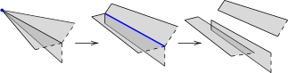

参考文献:

- 
- 

合集: 

下一集: 

## 简介

本文说明适当的[分层空间](分层.md)可通过所谓[出路范畴](出路范畴.md)的构造得到一个范畴, 直观上即 "只允许走向更高分层" 的道路构成的范畴:
$$
\mathsf{Exit}\colon \mathsf{Strat} \to \mathsf{Cat}.
$$
且在本文研究的 "锥光滑分层空间" 的子范畴上, $\mathsf{Exit}$ 为[全忠实函子](全忠实函子.md).

由于上述构造, $\infty$-范畴可以用锥光滑分层空间来[探测](探测.md), 从而视为这种分层空间的范畴上的层. 本文具体给出了一个层构成 $\infty$-范畴须满足的条件, 称之为**条纹层** (striation sheaves),
$$
\mathsf{Stri}\hookrightarrow \mathsf{Psh}(\mathsf{Strat}),
$$
并证明有范畴等价
$$
\mathsf{Stri} \simeq \mathsf{Cat}.
$$
换言之, 条纹层提供了 $\infty$-范畴的一个[模型](无穷范畴的模型.md), 其特点在于方便通过几何来构造一些通过单纯集等模型难以企及的无穷范畴. 无穷范畴的反转态射的对称性在这种模型中体现为 Poincaré 对偶.

## 1 锥光滑分层空间

定义 $C^0$ 分层空间为如下操作生成的最小类:

- 空空间 $\varnothing$;
- 紧 $C^0$ 分层空间 $X$ 的开锥 $C(X)$ 也是 $C^0$ 分层空间;
- 对乘积封闭;
- 对开子空间封闭;
- 能被 $C^0$ 分层空间开覆盖的分层空间也是 $C^0$ 分层空间.

归纳定义**锥光滑分层空间** (conically smooth stratified space) 为 $C^0$ [分层空间](分层.md) $X$, 带有**锥光滑图册** (conically smooth atlas)
$$
\{ \mathbb R^i \times C(Z) \hookrightarrow X\},
$$
其中 $Z$ 是深度严格小于 $X$ 的紧的锥光滑分层空间. 每个 "坐标卡" $\mathbb R^i \times C(Z)$ 包含一个锥点部分
$$
\mathbb R^i\times * \hookrightarrow \mathbb R^i \times C(Z),
$$
其在分层结构中处于较低层级. 空间 $Z$ 的每个点都对应从锥点向外走出的一个方向. 当然 $Z$ 也可以是 $\varnothing$, 此时 $C(Z)$ 是单点, 这个坐标卡就像是普通的光滑流形的坐标卡.

我们还需要归纳地定义两个坐标卡之间的映射
$$
f\colon \mathbb R^i \times C(Y) \to \mathbb R^j \times C(Z)
$$
何时**光滑**.

- 在 $\mathbb R^i \times C(Y)$ 的锥点之外的部分, 光滑性通过 $Y$ 的各个坐标卡归纳定义. (因为 $Y$ 的深度较小, 可以假设光滑性已经定义好了.)
- 考虑 $\mathbb R^i \times C(Y)$ 的锥点, 注意锥点未必打到锥点, 但是若不打到锥点则光滑性可由上一款定义, 故在此假设锥点打到锥点.

注意光滑映射可以把低维数部分打到高维数部分.

## 2 可构造层

### 2.4 范畴 $\mathsf{Strat}$

分层空间的范畴 $\mathsf{Strat}$ 一开始是 $(1,1)$-范畴, 但实际上它可[充实](充实范畴.md)于[生象](Ani.md), 即构成 $(\infty,1)$-范畴. 它可由如下的 Kan 复形充实结构 $\underline{\operatorname{Hom}}_{\mathsf{Strat}}$ 定义:
$$
\underline{\operatorname{Hom}}_{\mathsf{Strat}}(X,Y)[n] :=\operatorname{Hom}_{\mathsf{Strat}_{/\Delta^n}}(X\times\Delta^n, Y\times\Delta^n).
$$
它还有一个性质: $(\infty,1)$-范畴版本的 $\mathsf{Strat}$ 是 $(1,1)$-范畴版本关于所有投影 $X\times\mathbb{R}\to X$ 的[局部化](局部化(范畴论).md). 我们将主要使用 $(\infty,1)$-范畴版本, 除非特殊说明.

### 2.5 几类特殊余极限

#### 爆破

我们心目中的基本图像是, 开锥 $C(L)$ 是由 $L\times \left[0,1\right)$ 将 $L\times\{0\}$ 粘成一点所得. 这也可以想象为对锥点作 "奇点消解", 又称为**爆破** (blow-up), 得到一个以 $L$ 为边界的分层空间.
$$
\begin{CD}
L @>>> L\times \left[0,1\right) \\
@VVV @VVV \\
\{0\} @>>> C(L)
\end{CD}
$$

对于一般的分层空间 $X$, 从最底层逐层往上重复爆破 (每次都消解最底层的奇点), 可得一个**拉开** (unzip) 映射
$$
\operatorname{Unzip}(X) \to X.
$$
这个操作像是拉开拉链:

一般地, 有如下结论.

**命题-定义** (拉开, 链环). 对于分层空间的闭嵌入 $Y\hookrightarrow X$ 可作 $\operatorname{Unzip}_Y(X) \to X$, 且存在唯一的交换图
$$
\begin{CD}
\operatorname{Link}_Y (X) @>>> \operatorname{Unzip}_Y (X) \\
@VVV @VVV \\
Y @>>> X,
\end{CD}
$$
使得

- 该方块同时为拉回和推出方块;
- 每个态射均为紧合弱可构造层 (即在每个分层内局部平凡);
- $\operatorname{Link}_Y (X) \to\operatorname{Unzip}_Y (X)$ 为 $\operatorname{Unzip}_Y (X)$ 的闭面的嵌入, 称之为 $Y$ 在 $X$ 中的**链环** (link);
- $\operatorname{Unzip}_Y (X) \to X$ 在 $X\setminus Y$ 上为同构.

**推论**. 对于锥光滑分层空间 $X$ 的最底层 $X_d\subset X$, 方块
$$
\begin{CD}
\operatorname{Link}_{X_d}(X) @>>> \operatorname{Unzip}_{X_d}(X) \\
@VVV @VVV \\
X_d @>>> X
\end{CD}
$$
为 $\mathsf{Strat}$ 中的[推出](推出.md)方块.

#### 迭代锥

记 $\overline{C}(L)$ 为闭锥 $L\times [0,1] / L \times \{0\}$.

**命题**. 对分层空间 $L$, 下图为 $(\infty,1)$-范畴 $\mathsf{Strat}$ 中的推出方块:
$$
\begin{CD}
{*} = \overline{C}(\varnothing) @>>> \overline{C} (L) \\
@VVV @VVV \\
[0,1] = \overline{C}^2 (\varnothing) @>>> \overline{C} ^2 (L).
\end{CD}
$$
注意这个图在 $(1,1)$-范畴版本的 $\mathsf{Strat}$ 中不是推出, 在局部化后才是推出.

## 3 出路范畴

**命题**.
"出路范畴" 函子
$$
\mathsf{Exit}\colon \mathsf{Strat}\hookrightarrow \mathsf{sAni},\, X\mapsto ([n]\mapsto\operatorname{Hom}_{\mathsf{Strat}}(\Delta^n, X))
$$
是[全忠实函子](全忠实函子.md), 且其像落在范畴 (即[完备 Segal 生象](范畴对象.md)) 的范畴 $\mathsf{Cat}\hookrightarrow\mathsf{sAni}$ 中.

**命题**. 函子 $\mathsf{Exit}\colon \mathsf{Strat}\hookrightarrow\mathsf{Cat}$ 保持上节所述的 "拉开" 以及 "迭代锥" 几种推出方块.

## 4 条纹层

