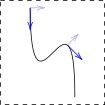
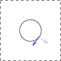

## 定义

标架流形是带有标架的流形. **标架**是平凡群到 $\mathrm{GL}_n$ 的同态 $1\to\mathrm{GL}_n$ 对应的[切结构](切结构.md).

**标架子流形**有时是指[法丛](法丛.md)的平凡化, 但还有一种不同的概念是下面定义的 Gauss 映射的平凡化.

### 标架子流形 (Gauss 映射的平凡化)

**定义** (标架子流形, [Lurie](LurieCob.md) 4.4.1). 设 $k,n$ 为自然数, $M$ 是 $m$ 维流形带有 $(n+k)$-标架 ($m \leq n+k$). 定义 $M$ 的 $k$-**标架子流形** (又称[标架缠结](缠结.md)) 为如下资料:

- 余 $n$ 维子流形 $M_0\subset M$ (直观: $M_0$ 通过继承 $M$ 的 "微小加厚" 当作 $k$ 维流形, 余维数在加厚前后不变); 特别地, 当 $m< n$ 时 $M_0 = \varnothing$;
- $M_0$ 的 [Gauss 映射](Gauss映射.md) $M_0\to\mathrm{Gr}_{n}(\mathbb{R}^{n+k}) = \mathrm{O}(n+k)/(\mathrm{O}(n)\times\mathrm{O}(k))$ 的一个零伦.

**注**. 这里标架子流形的 "标架" **不是**切丛或法丛的平凡化, 也不是任何一个单独的向量丛的平凡化; 它是子丛作为一个丛映射的平凡化. 当余维数 $n$ 趋于 $\infty$ 时, $\mathrm{Gr}_n(\mathbb{R}^{n+k})$ 的余极限为 $\mathbf{B}\mathrm{O}(k)$, 它退化到标架流形的 "标架".

**例**. 如下是 $\mathbb{R}^{1+1}$ 的一个 $1$-标架子流形 ($n=k=1$):

注意, 下图的圆圈**不是** $\mathbb{R}^{1+1}$ 的 $1$-标架子流形! 尽管圆圈的切丛和法丛都平凡, 但 Gauss 映射 $S^1\to\mathrm{Gr}_1(\mathbb{R}^2) = \mathbb{R}P^1$ 不平凡
(它是 $\mathrm{Gr}_{1,2}$ 的二重覆叠).

**例**. 仍设 $n=k=1$, $n+k=2$. 考虑 $\mathbb{R}$ 作为 $2$-标架流形 (微小加厚), 那么 $\mathbb{R}$ 的一个 $1$-标架子流形是一个离散点集, 每个点带有 $*\to\mathrm{Gr}_1(\mathbb{R}^2) = \mathbb{R}P^1$ 的一个零伦, 这等同于一个 $\pi_1\mathrm{Gr}_1(\mathbb{R}^2) \simeq\mathbb{Z}$ 的元素. 作为对比, $1$-标架的 $0$ 维流形等同于离散点集每个点带一个正负号.

**例**. 设 $n=2$, $k=1$, $n+k=3$. 三维空间中的圆圈 ([纽结](纽结.md)) **是** $\mathbb{R}^{2+1}$ 的 $1$-标架子流形. 因为它的 Gauss 映射 $S^1\to\mathrm{Gr}_1(\mathbb{R}^3) = \mathbb{R}P^2$ 零伦 (它是 $\pi_1\mathbb{R}P^2 \simeq\mathbb{Z}/2$ 的生成元的两倍). 进一步, 我们知道它上面有 $\pi_2\mathbb{R}P^2\simeq\mathbb{Z}$ 那么多种标架.

纽结的标架的另一个常见的定义是 Gauss 映射提升到 $\mathrm{SO}(3)$, 这等同于纽结法丛的平凡化: 注意到纤维列
$$
\mathrm{O}(2)\to\mathrm{SO}(3) \to \mathrm{Gr}_1(\mathbb{R}^3)\to\mathbf{B}\mathrm{O}(2),
$$
我们知道 Gauss 映射提升到 $\mathrm{SO}(3)$ 的方式等同于复合映射 $S^1\to\mathbf{B}\mathrm{O}(2)$ 零伦的方式, 而这个复合映射正是纽结的法丛作为抽象向量丛的分类映射, 故其零伦正是纽结法丛的平凡化.

对于给定的一个零伦映射 $S^1\to X$, 其零伦方式的全体为 $\Omega^2 X$. 若仅关心标架信息的 $0$-截断, 纽结标架的两种定义等价:
$$
\pi_2\mathrm{Gr}_1(\mathbb{R}^3)\overset{\simeq}{\to}\pi_2\mathbf{B}\mathrm{O}(2)\simeq\mathbb{Z}.
$$
换言之, 一个给定纽结的标架一一对应于整数. 直观上这个数就是丝带的缠绕数.