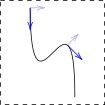
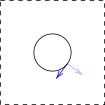
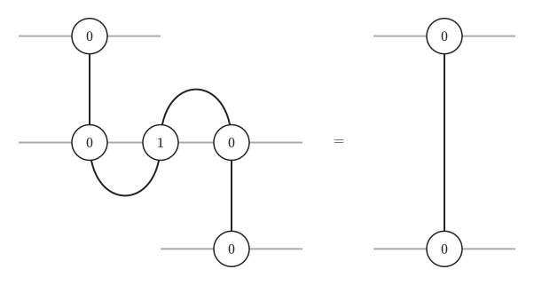

## 观念

**缠结假设** (tangle hypothesis) 是一系列关于各维数的[缠结](缠结.md)构成的[高阶范畴](高阶范畴.md)的万有性质的命题.

缠结假设可由[带奇点配边假设](cob-sing.md)推出, 直观上因为缠结可视为以球面为奇点数据的 "假奇点".

**注**. 由于文献 ([Lurie](LurieCob.md), [Ayala–Francis](AyalaFrancisCob.md) 等) 记号不一 (尤其是指标含义不一), 此处使用的是一个和他们都不相同, 但看上去比较合理的记号.

我们的指标 $k,n$ 有如下固定的含义:

- 缠结范畴 $\mathsf{Tang}_k^{\mathbb E_n}$ 是 $\mathbb E_n$-幺半 $(\infty,k)$-范畴. 它是 $\mathsf{Tang}_k^V$ 在 $V = \mathbb{R}^n$ 的特殊情形, 一般地 $V$ 是个标架 $n$ 维流形.

## 陈述

### 标架子流形

对于 $m\leq n$, 一个 $m$ 维流形 $M$ 带有 $n$-[标架](标架流形.md) (即 $TM\oplus \mathbb{R}^{n-m}$ 的平凡化) 时, 我们可以将其 "微小加厚", 当作标架 $n$ 维流形 $M\times D^{n-m}$. 这样思考的好处是: 当我们谈论标架带边流形的边界 (甚至边界的边界...) 时, 可将边界 "微小加厚", 于是边界 (边界的边界) 与原流形是同维数的流形, 这样边界标架的相容性就变得完全直观了. 下面的定义都可以采用这一直观来理解.

**定义** (标架子流形, [Lurie](LurieCob.md) 的定义 4.4.1). 设 $k,n$ 为自然数, $M$ 是 $m$ 维流形带有 $(n+k)$-标架 ($m \leq n+k$). 定义 $M$ 的 $k$-**标架子流形** (又称[标架缠结](缠结.md)) 为如下资料:

- 余 $n$ 维子流形 $M_0\subset M$ (直观: $M_0$ 通过继承 $M$ 的 "微小加厚" 当作 $k$ 维流形, 余维数在加厚前后不变); 特别地, 当 $m< n$ 时 $M_0 = \varnothing$;
- $M_0$ 的 Gauss 映射 $M_0\to\mathrm{Gr}_{n,n+k} = \mathrm{O}(n+k)/(\mathrm{O}(n)\times\mathrm{O}(k))$ 的一个零伦.

**注**. 标架子流形的 "标架" **不是**切丛或法丛的平凡化, 也不是任何一个单独的向量丛的平凡化; 它是子丛作为一个丛映射的平凡化. 当余维数 $n$ 趋于 $\infty$ 时, $\mathrm{Gr}_{n,n+k}$ 的余极限为 $\mathbf{B}\mathrm{O}(k)$, 它退化到标架流形的 "标架".

**例**. 如下是 $\mathbb{R}^{1+1}$ 的一个 $1$-标架子流形 ($n=k=1$):

注意, 下图的圆圈**不是** $\mathbb{R}^{1+1}$ 的 $1$-标架子流形! 尽管圆圈的切丛和法丛都平凡, 但 Gauss 映射 $S^1\to\mathrm{Gr}_{1,2} = \mathbb{R}P^1$ 不平凡
(它是 $\mathrm{Gr}_{1,2}$ 的二重覆叠).

**例**. 仍设 $n=k=1$, $n+k=2$. 考虑 $\mathbb{R}$ 作为 $2$-标架流形 (微小加厚), 那么 $\mathbb{R}$ 的一个 $1$-标架子流形是一个离散点集, 每个点带有 $*\to\mathrm{Gr}_{1,2} = \mathbb{R}P^1$ 的一个零伦, 这等同于一个 $\pi_1\mathrm{Gr}_{1,2} \simeq\mathbb{Z}$ 的元素. 作为对比, $1$-标架的 $0$ 维流形等同于离散点集每个点带一个正负号.

**例**. 设 $n=2$, $k=1$, $n+k=3$. 三维空间中的圆圈 ([纽结](纽结.md)) **是** $\mathbb{R}^{2+1}$ 的 $1$-标架子流形. 因为它的 Gauss 映射 $S^1\to\mathrm{Gr}_{1,3} = \mathbb{R}P^2$ 零伦 (它是 $\pi_1\mathbb{R}P^2 \simeq\mathbb{Z}/2$ 的生成元的两倍). 进一步, 我们知道它上面有 $\pi_2\mathbb{R}P^2\simeq\mathbb{Z}$ 那么多种标架.
这个整数可理解为丝带的缠绕数. 详见[标架流形](标架流形.md)页面中的讨论.

**注**. 虽然叫做 $k$-标架子流形, 但在我看来它的余维数 $n$ 是一个更本质的量. 这个余维数 $n$ 正是定义 $\mathsf{Tang}_k^V$ 所用的 "背景流形" $V$ 的维数. 我认为另一件事情也和这个 $n$ 有关: 在[流形图](notes-manifold-diagrams.md)中, 最高维区域表示对象, 而余 $n$ 维区域表示 $n$-态射.

### 缠结范畴

我们用 $\mathsf{Tang}_{k}^{\mathbb E_n}$ 表示如下的 [$\mathbb E_n$](En-代数.md)-幺半 [$(\infty,k)$-范畴](∞-n-范畴.md):

- 其对象为 $\mathbb{R}^n$ (或 $n$ 维圆盘 $D^n$) 中的 $k$-标架 $0$ 维紧子流形, 其上 $\mathbb E_n$-结构是直观的;
- 其 $i\leq k$ 阶态射为 $\mathbb{R}^{i+n}$ 中的 $i$ 维 $k$-标架紧子流形;
- 其高于 $k$ 阶态射为[同痕](同痕.md).

如下是 $\mathsf{Tang}_1^{\mathbb E_2}$ 中的一个 $1$-态射的示意 (未画出标架).

### 缠结假设的陈述

**命题**. 范畴 $\mathsf{Tang}_{k}^{\mathbb E_n}$ 是一个[完全可对偶对象](完全可对偶对象.md)所[自由](自由-遗忘伴随.md)生成的 [$\mathbb E_n$](En-代数.md)-幺半 [$(\infty,k)$-范畴](∞-n-范畴.md).

等价的陈述是: 范畴 $\mathsf{Tang}_{k}^{\mathbb E_n}$ 是一个对象自由生成的[刚性](刚性幺半范畴.md) [$\mathbb E_n$](En-代数.md)-幺半 [$(\infty,k)$-范畴](∞-n-范畴.md).
这就是说, 对任意含对偶的 $\mathbb E_n$-幺半 $(\infty,k)$-范畴 $\mathcal C$, 有等价
$$
\mathsf{Fun}_{\mathbb E_n}(\mathsf{Tang}_k^{\mathbb E_n},\mathcal C) \simeq \mathcal C^{\simeq}.
$$

**例**. $k=0$ 的情形: $\mathsf{Tang}_0^{\mathbb E_n}$ 是一个元素自由生成的 $\mathbb E_n$-幺半群. 它就是 $\mathbb{R}^n$ 上有限个互异点的[构形空间](构形空间.md).

**例**. 设 $n=k=1$; $\mathsf{Tang}_1^{\mathbb E_1}$ 是一个[可对偶对象](可对偶对象.md)自由生成的幺半 $(\infty,1)$-范畴. 由前面关于 $\mathbb{R}$ 与 $\mathbb{R}^{2}$ 的 $1$-标架子流形的讨论, 我们知道

- 其对象为 $\mathbb{R}$ 中的 $1$-标架 $0$ 维紧子流形, 即 $\mathbb{R}$ 的有限子集每个元素带一个整数标记 (也就是整数的有限序列).
- 带标记 $0$ 的点, 其左右对偶分别为带 $-1$ 和 $1$ 标记的点. $-1$ 和 $1$ 在这里并不同构. 一般地, $(a,b,c)$ 的右对偶是 $(c+1,b+1,a+1)$.

**例**. 设 $n=2$, $k=1$; $\mathsf{Tang}_1^{\mathbb E_2}$ 是一个可对偶对象自由生成的[辫幺半 $(\infty,1)$-范畴](辫幺半范畴.md). 特别地, 给定辫幺半范畴 $\mathcal C$ 的[可对偶对象](可对偶对象.md) $V$, 就能给出一个[纽结不变量](纽结.md), 称为 [Reshetikhin–Turaev 不变量](RTinv.md).

### 逆环版本

由于[逆环假设](逆环假设.md), 上述命题还有一个用 $(\infty,n+k)$-范畴
$$
\mathsf{Tang}_{k}^{(n)}
:= \mathrm{B}^n \mathsf{Tang}_{k}^{\mathbb E_n}
$$
陈述的版本. 这个 [$(\infty,n+k)$-范畴](∞-n-范畴.md)可以描述如下:

- 其 $i$ 阶态射为 $\mathbb{R}^{i}$ 中的余 $n$ 维带标架[缠结](缠结.md) (特别地, $i<n$ 阶态射唯一);
- 其高于 $n+k$ 阶态射为[同痕](同痕.md).

**命题**. 范畴 $\mathsf{Tang}_{k}^{(n)}$ 是一个基点的[完全可伴随](完全可对偶对象.md) $n$ 阶自同态所[自由](自由-遗忘伴随.md)生成的 [$(\infty,n+k)$-范畴](∞-n-范畴.md).

### 一般背景流形的版本

缠结范畴 $\mathsf{Tang}_k^{\mathbb E_n}$ 可视为范畴 $\mathsf{Tang}_k^{\mathbb E_V}$ 在 $V = \mathbb{R}^n$ 的特例. 其大致描述如下:

- $\mathsf{Tang}_k^{\mathbb E_V}$ 的对象为 $V$ 的 $0$ 维 $k$-标架紧子流形;
- 一般地, $\mathsf{Tang}_k^{\mathbb E_V}$ 的 $i\leq k$ 阶态射为 $V\times\mathbb{R}^i$ 中的 $k$-标架紧子流形;

很明显, $\mathsf{Tang}_k^{\mathbb E_V}$ 具有 [$\mathbb E_V$](E_M-算畴.md)-结构.

### 与配边假设的关系

[配边范畴](配边范畴.md) $\mathsf{Bord}_k$ 是
$\mathsf{Tang}_{k}^{\mathbb E_n}$
"在 $n \geq \infty$ 的极限"; 人们也称其为**稳定**情形. 此时 (至少直观上) 缠结假设趋向于[配边假设](配边假设.md): $\mathsf{Bord}_k$ 是一个[完全可对偶对象](完全可对偶对象.md)所[自由](自由-遗忘伴随.md)生成的[对称幺半](对称幺半范畴.md) [$(\infty,k)$-范畴](∞-n-范畴.md).